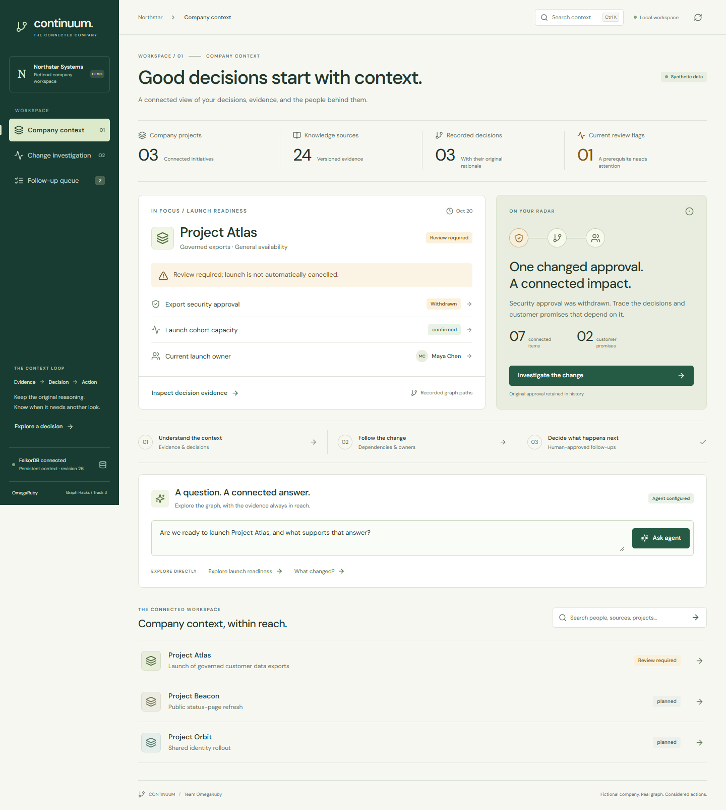
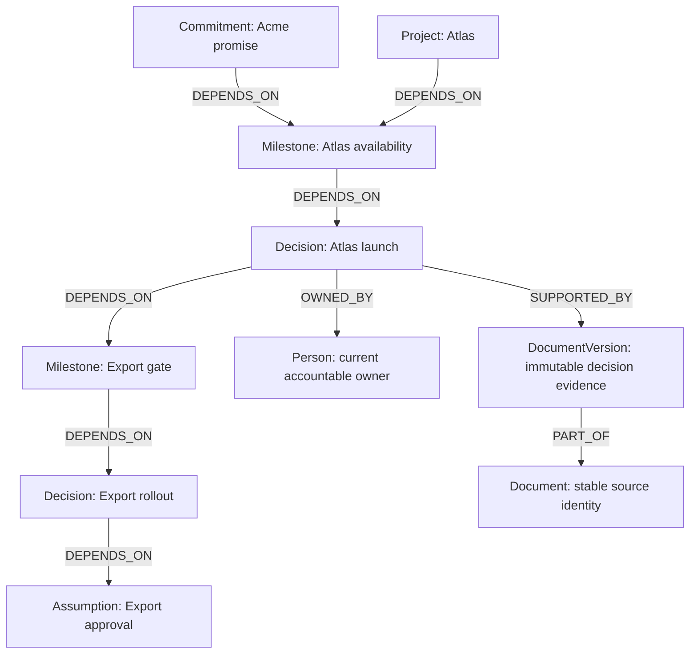

# CONTINUUM

**A company brain that knows when decisions become outdated—and helps the right people respond.**

Team **OmegaRuby** · Graph Hacks by WeMakeDevs and FalkorDB · **Track 3 — Company Brain**

**Demo video:** [Watch CONTINUUM on YouTube](https://youtu.be/ZBFiwe2X2jM) · **Blog:** [Building a Company Brain That Knows When Decisions Need Review](https://dev.to/navneetcerecode/continuum-building-a-company-brain-that-knows-when-decisions-need-review-3pj8)

**Live demo:** [CONTINUUM on Railway](https://continuum-omegaruby-production.up.railway.app/). Account access is required; the team provides judge credentials separately. The deployment uses private persistent FalkorDB and Groq Free model inference. [Cloud setup and verification](docs/CLOUD.md) records the trial limits and executed checks. Complete local setup remains available below.

CONTINUUM connects launch decisions to their evidence, dependencies, customer commitments and current owners. When a security approval changes, it traces the recorded dependencies and proposes a human-reviewed response. A changed assumption flags a decision for review; it does not declare it wrong or cancel the launch.



The frontend redesign includes responsive context, dependency investigation and follow-up review, keyboard workspace search (Ctrl/Cmd+K), and an evidence explorer. Read the [design audit](docs/DESIGN_AUDIT.md) and [design verification](docs/DESIGN_VERIFICATION.md) for scope, screenshots, and test evidence.

## Graph data model

The graph represents fictional Northstar Systems. This representative Atlas chain shows the stored direction: **dependent → prerequisite**. Only `DEPENDS_ON` propagates impact; source, ownership and membership links do not. Impact investigation follows incoming dependency paths from the changed prerequisite.



| Nodes | Role and relationships |
|---|---|
| Project, Milestone, Decision, Assumption, Commitment | Operational prerequisites connected by `DEPENDS_ON`. A withdrawn assumption flags dependent readiness for review while preserving the original decision. |
| Document, DocumentVersion | Versioned evidence via `SUPPORTED_BY` and `PART_OF`; `SUPERSEDES` retains older versions and assumptions. |
| Person, Team | Sourced `OWNED_BY` records and `MEMBER_OF` membership. Authority and effective dates resolve current ownership; conflicts remain visible. |
| ChangeEvent | Retains the change and its bounded impact snapshot; `AFFECTS` records affected membership. |
| ResponsePlan, ProposedAction, ActionItem | A plan `HAS_PROPOSAL`; an explicitly approved task is `CREATED_FROM` a proposal, `ASSIGNED_TO` a person, `FOR_DECISION` a decision/commitment, and `TRIGGERED_BY` the event. |
| RestorationReview | `PROPOSES` a replacement assumption, `REVALIDATES` reviewed items, `RESOLVES` the event, and records the person through `REVIEWED_BY`. Completing tasks alone does not restore approval. |
| Workspace | Stores the graph revision used to reject stale mutations and approvals. |

The complete [graph model](docs/GRAPH_MODEL.md) specifies validity, authority, historical snapshots, repeated cycles and every relationship. Relationships are curated metadata from synthetic sources, not automatic extraction from arbitrary prose.

### How the agent queries FalkorDB

A question enters the bounded model loop in [backend/agent.py](backend/agent.py). The model selects one of **eight typed, read-only tools**; the backend validates its arguments and executes parameterized FalkorDB queries. It returns graph paths, source versions, ownership conflicts and persisted records. The final answer must cite retrieved source IDs and complete returned paths. The model cannot issue arbitrary Cypher, approve tasks or send messages.

| Agent tool | Graph work |
|---|---|
| `search_company_context` | Find stable entity IDs by name or ID. |
| `assess_launch_readiness` | Traverse project dependencies; check required assumptions, evidence validity/authority and ownership. |
| `trace_change_impact` | Find incoming `DEPENDS_ON` paths to a changed prerequisite. |
| `get_decision_evidence` | Retrieve the exact `DocumentVersion` excerpts linked to a record. |
| `resolve_current_owner` | Retrieve sourced `OWNED_BY` records and resolve authority/date conflicts. |
| `get_change_event` | Read a selected incident, retained impact snapshot, evidence and readiness. |
| `get_open_followups` | Read graph-backed events and action items for a project or workspace. |
| `propose_followup_plan` | Preview work from retrieved impact and owners; does not persist or approve it. |

For example, the current-impact query finds dependents of `$id` and returns the evidence attached to each dependency edge:

```cypher
MATCH p=(n)-[:DEPENDS_ON*1..8]->(a {id:$id})
WHERE (n:Decision OR n:Milestone OR n:Commitment OR n:Project)
  AND all(r IN relationships(p) WHERE coalesce(r.current,true)=true)
RETURN n.id AS id, n.name AS name, labels(n) AS labels,
       [v IN nodes(p) | v.id] AS path,
       [e IN relationships(p) | properties(e)] AS edges,
       length(p) AS depth
ORDER BY depth, id LIMIT 201;
```

Traversal is bounded to eight hops and 200 retained paths. The 201st path and a separate beyond-depth query detect incomplete impact; incomplete investigation blocks plans. See [essential Cypher queries](docs/QUERIES.cypher) and the actual implementations in [backend/graph.py](backend/graph.py) and [backend/service.py](backend/service.py).

**Actual agent evidence:** the [recorded cloud investigation](artifacts/cloud-agent.json) called `assess_launch_readiness` for Beacon and returned `project-beacon → milestone-beacon → decision-beacon → approval-beacon`, with four supporting source versions. These paths and citations come from FalkorDB. Schema, source-ID and path validation do not prove every natural-language sentence; prose entailment remains unverified.

FalkorDB is central to this behavior: it stores organizational context, history, plans and tasks, and executes dependency/evidence/ownership queries. There is no fallback organizational database or application-side topology traversal. Database unavailability produces an unavailable state. The model investigates; explicit application approval controls mutations.

## Run locally

Public source: [navneet-cerecode/continuum-omegaruby](https://github.com/navneet-cerecode/continuum-omegaruby). Team **OmegaRuby**, Track 3 — Company Brain. [Release v0.2.0](https://github.com/navneet-cerecode/continuum-omegaruby/releases/tag/v0.2.0) includes the recorded demo, reviewable source archive and verification report. Uploaded assets were downloaded again and their SHA-256 hashes verified.

Windows setup helper: start FalkorDB, then run `scripts\setup-native.ps1`. It installs the locks, builds the UI and seeds the graph. See [release verification](docs/RELEASE.md) for fresh-archive setup evidence.

Prerequisites: Docker Desktop with Linux engine running. Optional: Ollama for free local model inference.

```powershell
Copy-Item .env.example .env
docker compose up --build -d
```

Open http://127.0.0.1:8000. The container imports the fixture automatically and serves the React build through FastAPI. The database uses a named persistent volume and AOF. Restart with `docker compose restart app`; stop with `docker compose stop`. Do not remove the named volume if you want to preserve history.

For the verified free local agent, install [Ollama](https://ollama.com/download/windows), then:

```powershell
ollama pull llama3
```

Set these values in `.env` and recreate the app container:

```dotenv
LLM_MODEL=llama3:latest
LLM_API_STYLE=ollama_json
LLM_BASE_URL=http://host.docker.internal:11434
```

Ollama must be reachable from the container. Its default Windows listener is loopback; if Docker cannot reach it, use the native backend instructions below, which work with Ollama's default listener. No account or API key is required for local inference. `ollama_json` lets the model select typed tools through a validated JSON protocol, then constrains its answer to source IDs and complete paths returned by those tools. It is genuine model-selected tool use, not a scripted sequence. The model may still make unsupported natural-language claims; inspect its evidence and limitations. Native tool-capable Ollama models can use `LLM_API_STYLE=ollama` instead.

For another provider, set `LLM_MODEL`, `LLM_API_KEY`, `LLM_BASE_URL` and `LLM_API_STYLE=responses` or `chat_completions` to match its API. Secrets stay server-side. Without configured inference, deterministic graph exploration works and the model button is disabled. See [verification status](docs/VERIFICATION.md) before making agent or deployment claims.

### Native development on Windows

Python 3.12 and Node 24.12 were used. From the repository root:

```powershell
docker compose up -d falkordb
py -3.12 -m venv .venv
.\.venv\Scripts\python.exe -m pip install -r requirements.lock.txt
npm.cmd --prefix frontend ci
npm.cmd --prefix frontend run build
.\.venv\Scripts\python.exe -m backend.seed
.\.venv\Scripts\python.exe -m uvicorn backend.main:app --host 127.0.0.1 --port 8000
```

For native inference use `LLM_BASE_URL=http://127.0.0.1:11434`. For frontend development run `npm.cmd --prefix frontend run dev` in a second terminal; Vite proxies `/api` to port 8000.

Docker Desktop on the original implementation machine failed because of its inference socket, so native verification used the **official FalkorDB 4.14.11 module on Redis 8.0.5 in existing Ubuntu WSL**, with persistent files in ignored `.runtime/database`. The [fallback instructions](docs/LOCAL_RUNTIME.md) reproduce that setup. The application image build and container lifecycle were subsequently verified on Linux CI; the Railway deployment also runs the application container. See [cloud verification](docs/CLOUD.md) for those later checks.

## Signature workflow

Use **Project** and **Prerequisite** to investigate Atlas, Beacon or Orbit. Readiness, plans, queues, restoration and agent questions follow that scope. All three complete workflows are verified; see [multi-project verification](docs/MULTI_PROJECT.md). Atlas remains the signature scenario below.

1. Inspect Atlas readiness and its graph paths. The older brief names Ethan Park; the current authoritative register names Maya Chen. Open both sources.
2. Click **Introduce security update**. This applies a clearly synthetic withdrawal and preserves the old approval.
3. Inspect the **seven** affected graph items and the five-hop path to each customer commitment. Beacon and Orbit are excluded from recorded impact.
4. Click **Generate response plan**. Select the tasks to create, inspect the communication draft, then approve the selection.
5. Open a fresh browser session. Use **What changed?** or ask the agent: “What changed, why was the launch flagged, and what remains unresolved?” History and tasks come from FalkorDB.

6. Open **Change investigation** to record replacement security evidence. Close open follow-ups, refresh the replacement review, confirm every affected item and add a rationale. **Revalidate and resolve withdrawal** activates the new approval while retaining the original history. See [restoration workflow](docs/RESTORATION.md).

No real communication is sent. Completing an action alone does not restore approval. Replacement evidence and explicit revalidation are separate steps; final launch sign-off remains with the launch lead. Reviewer identity is a clearly labeled synthetic role in this local demo.

After restoration, choose **Record another update** to begin the next cycle. **Incident history** lets you inspect earlier evidence and resolutions while current readiness stays separate. Selection survives a fresh page. See [repeated cycles and history](docs/CYCLES.md).

To rehearse from a clean baseline without deleting existing history, choose a new `FALKORDB_GRAPH` name for the native backend and rerun `python -m backend.seed`, then restart the backend. Existing graphs remain intact.

## Data, graph, agent and approval

**Workspace library** adds paged browsing and reviewed synthetic Markdown batch imports. See [onboarding](docs/ONBOARDING.md). Optional [account mode](docs/ACCESS.md) adds sign-in, roles, company graph separation and account-bound reviewer records. The existing local demo remains accessible without credentials until accounts are explicitly provisioned and enabled.

- Fictional **Northstar Systems**: four teams, 12 people, three projects, 26 short Markdown sources, including two explicitly curated multi-project extensions. See [source manifest](data/manifest.json), [extension disclosure](docs/MULTI_PROJECT.md) and [independently specified Atlas impact](data/expected-impact.json).
- Relationships are **curated structured metadata**, not inferred from arbitrary prose. Names never serve as identity keys. Stable IDs establish identity; similarly named people are never silently merged.
- Import the fixture with `python -m backend.seed`. Import a local synthetic Markdown document with `python -m backend.seed --file path\to\source.md`. Version IDs are immutable; optional `supersedes` metadata creates a version history without moving historical decision evidence.
- FalkorDB executes dependency traversal, evidence retrieval, owner resolution, history and follow-up queries. There is no organizational fallback database or application-side graph traversal.
- One model selects bounded, typed tools. Unknown tools, extra arguments, invalid IDs, unsupported source citations and invented graph paths are rejected. Tools do not expose Cypher or approval/mutation operations. Trace shows calls, inputs, outcomes and timing, never hidden reasoning.
- Application approval uses an atomic graph revision comparison, a supporting-context fingerprint and deterministic IDs. Repeated approval does not create duplicate tasks. Changing evidence, paths or ownership makes old proposals stale.

Read the [graph model](docs/GRAPH_MODEL.md), [essential queries](docs/QUERIES.cypher), [architecture](docs/ARCHITECTURE.md), and [technical walkthrough](docs/WALKTHROUGH.md).

## Verification

Latest [cloud verification — October 17, 2026](docs/CLOUD.md): **129 tests passed on Linux CI**, with actual Docker lifecycle checks. Separate live Railway checks covered HTTPS login, origin/CSRF/role restrictions, a complete synthetic withdrawal/approval/restoration workflow, a real Groq model/tool response with graph citations, and unchanged recap records after a FalkorDB restart. See [executed cloud results](artifacts/cloud-verification.json) and the [CI run](https://github.com/navneet-cerecode/continuum-omegaruby/actions/runs/39030348326). The cloud app uses one worker/replica, Railway trial resources and Groq Free inference; these checks are not a production-readiness or prose-entailment claim.

Earlier [local release verification](docs/RELEASE.md): **114 tests passed**, real Chrome covers account/import/paging/company boundaries, five live local-model scenarios pass citation-coverage checks, and a 1,206-node synthetic graph returns the expected impact under concurrency one and four. Fresh archive setup passed on this machine. The [YouTube demo](https://youtu.be/ZBFiwe2X2jM) is the submission video; the earlier [silent release recording](artifacts/CONTINUUM-OmegaRuby-demo.mp4) remains available. Original demo records remain unchanged. See `artifacts/release-verification.json`; earlier checkpoints retain their own scope.

Latest [cycle verification](docs/CYCLES.md): **103 tests pass**, Chrome completed two cycles with historical selection on desktop/mobile, and two real local-agent calls distinguished an old resolution from a current withdrawal. Original demo records were preserved. Free-text citation quality still needs stronger evaluation. See `artifacts/cycles-verification.json`.

Earlier [multi-project verification](docs/MULTI_PROJECT.md): **90 tests pass**, Chrome completed independent Atlas/Beacon/Orbit lifecycles on desktop/mobile, and two real local-agent calls assessed Beacon/Orbit using their own evidence. Existing Atlas records were preserved. See `artifacts/multi-project-verification.json`; earlier checkpoints below retain their original scope.

Earlier [lifecycle verification](docs/RESTORATION.md): **80 tests pass**, the complete restoration flow passes in Chrome on desktop/mobile, and two real local-agent calls explain the restored state. Existing demo history and tasks were preserved. See `artifacts/lifecycle-verification.json`. The following 66-test hardening checkpoint retains its original scope.

The first [hardening pass](docs/HARDENING.md) adds conservative readiness, explicit traversal completeness, guarded document imports, stronger ownership resolution and local HTTP controls. **66 automated tests pass**, real local-model and desktop/mobile browser checks pass, and both dependency audits report zero known findings. Existing demo history and tasks were preserved. See `artifacts/hardening-verification.json` for the dated results.

```powershell
.\.venv\Scripts\python.exe -m pytest -q --basetemp=.runtime\pytest
.\.venv\Scripts\python.exe scripts\benchmark.py
```

Tests use real, isolated FalkorDB graphs and clean up only their own graph. Agent protocol tests use a simulated provider and are separately labeled. Browser verification needs Playwright and an installed Chrome; set `PLAYWRIGHT_MODULE` to the installed Playwright module and run `node scripts/browser-verify.cjs` against a fresh demo graph. It applies the synthetic update and approves two tasks.

[Actual verification and limitations](docs/VERIFICATION.md) · [Demo script](docs/DEMO.md) · [Submission copy](docs/SUBMISSION.md) · [AI and human contributions](docs/CONTRIBUTIONS.md)

## Boundaries

Default **local synthetic demo**, with optional account mode for authenticated company graph access. The [verified cloud demo](docs/CLOUD.md) requires accounts, Secure cookies and an exact HTTPS origin. No infrastructure-level tenant isolation, external connectors, automatic document extraction, notification sending, enterprise-scale claims or production readiness. Reviewed source batches, account authorization and record pagination are implemented; general prose entailment, distributed identity/quotas and an independent public security assessment remain unverified. See [release boundaries](docs/RELEASE.md).

The distinctive contribution is the path from **changed evidence → dependent decisions and promises → current accountable owners → approved, persisted response**, with the original rationale retained. A relational database can implement dependencies too; a graph makes this connected traversal and its provenance explicit. Future expansion could cover procurement or policy decisions after their authority, dependency and validity rules are defined. This submission implements launch readiness only.
