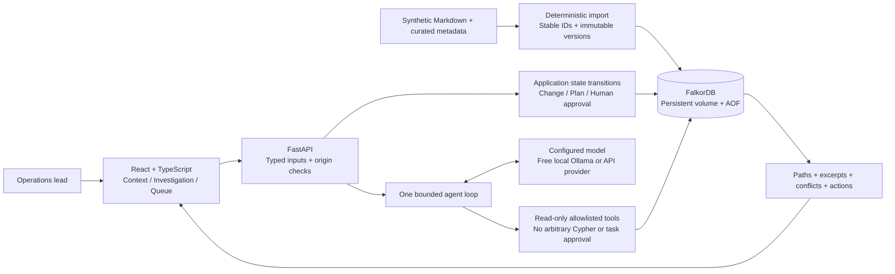

# Architecture — CONTINUUM / OmegaRuby

The frontend makes explicit `/api` requests. The backend uses the official FalkorDB Python client, parameterized queries and bounds. The model selects from eight read-only investigation tools; its output is validated against returned source IDs and complete paths. Natural-language entailment is still a review responsibility. The [README](../README.md#graph-data-model) shows the graph model and maps each tool to its graph work.

Local Ollama needs no API key and uses native `/api/chat` and a six-turn/ten-tool budget. The verified installed Llama 3 model uses a validated JSON protocol to select typed tools. After it retrieves source evidence, an answer schema constrains citations to returned source IDs and full graph paths. Native-tool Ollama models may instead use tool schemas with thinking output disabled. Hosted adapters support Responses or compatible Chat Completions. No hidden reasoning is retained in the trace. Each run must retrieve real sources before the application accepts a substantive answer. Invalid or unavailable inference is surfaced, not replaced by a canned agent response.

Task creation and lifecycle mutations use explicit application endpoints; model tools cannot invoke them. Browser-origin checks apply to writes, and local ports bind to loopback. The default local synthetic demo does not require login. Optional [account mode](ACCESS.md) enforces roles and server-selected company graphs; the [cloud deployment](CLOUD.md) requires accounts, Secure cookies, an exact HTTPS origin and CSRF tokens. This is application-level company separation, not an infrastructure-level tenant-isolation claim.

## Why a graph

The workflow is variable-depth dependency discovery with provenance at each step. FalkorDB finds the paths and the entities; the application formats returned results and deduplicates endpoints. It does not load JSON topology to reason in memory. SQL can also implement recursive dependencies; the graph model makes the relationships and explainable paths first-class for this demo.

## Scaling constraints

The fixture is small. Current evidence hydration uses multiple queries per impacted entity. Record browsing is paged, but dependency traversal retains eight-hop and 200-path bounds that can truncate a dense graph. Larger graphs need batched evidence queries, a strategy for complete large-path investigations, source authority governance, quality review and operational monitoring. The cloud app uses one worker and one replica because sessions, login limits and model concurrency are process-local; distributed identity/quotas remain future work. No vector database or graph algorithm unrelated to dependency semantics is used. A small synthetic latency result is not enterprise-scale evidence.
